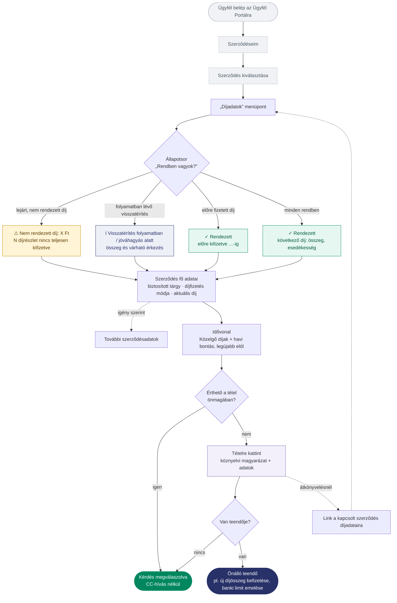
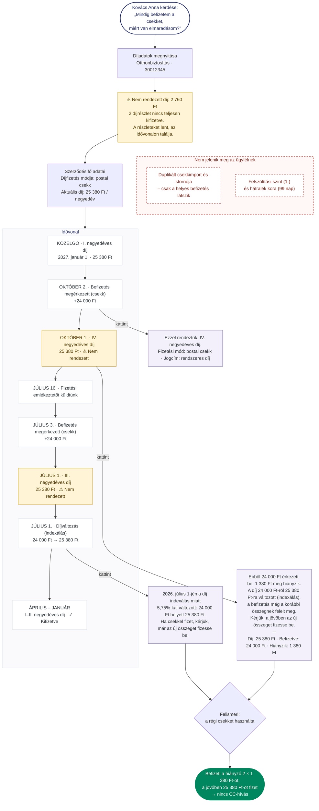
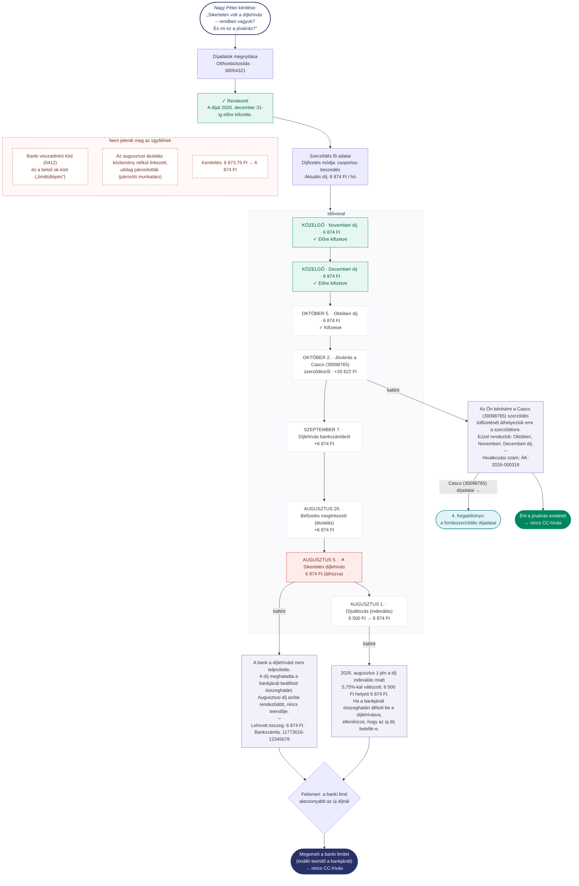
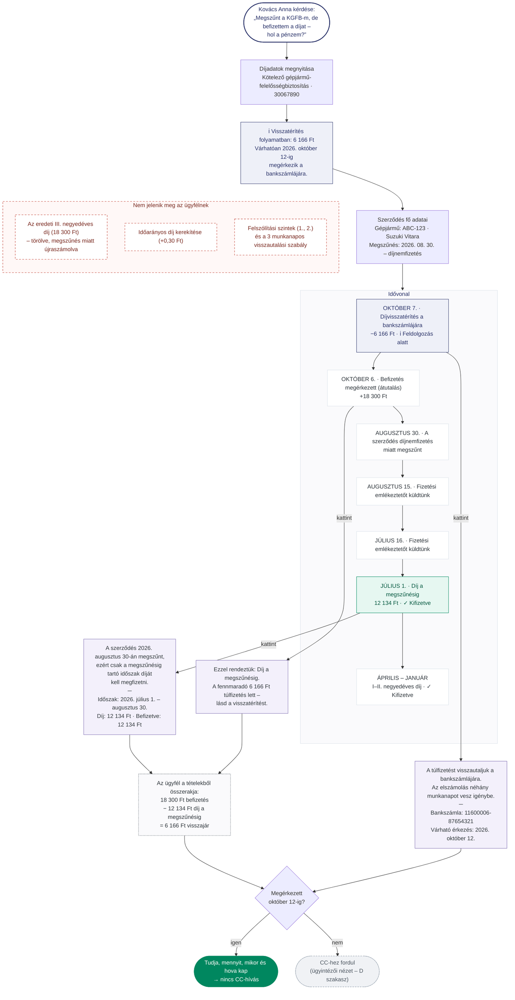
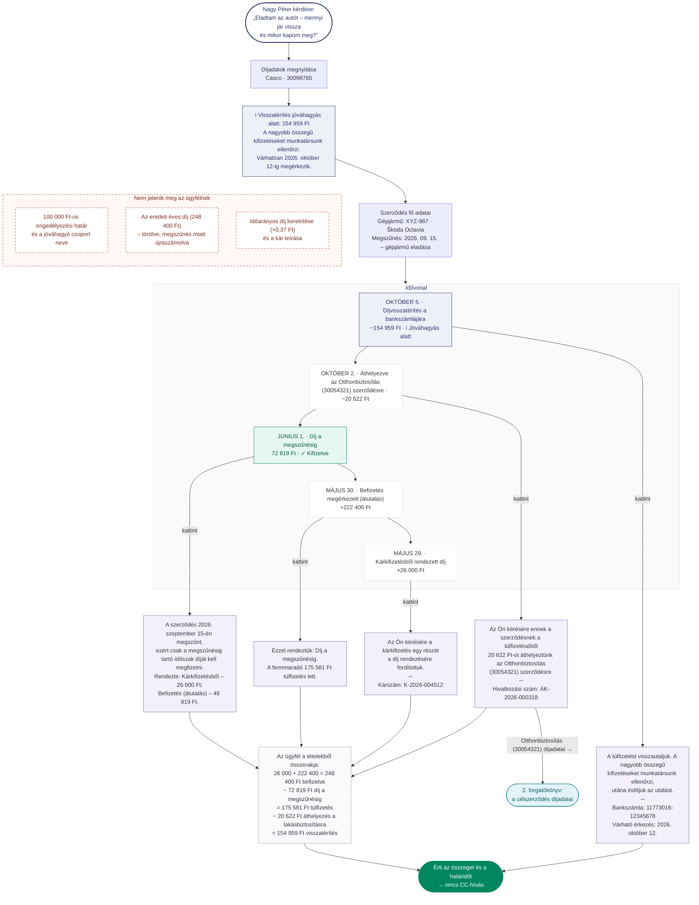

# Díjadatok – ügyfél nézet: felhasználói utak

Az ábrák a prototípus **ügyfél nézetét** mutatják be a 4 tesztforgatókönyvön keresztül: mit lát az ügyfél, hova kattint, milyen magyarázatot kap, és hogyan jut el a válaszig CC-hívás nélkül.
A szövegek a prototípusban megjelenő szövegek; a prototípus „mai napja” 2026. 10. 08.

**Jelmagyarázat**

| Szín | Jelentés |
|---|---|
| szürke, szaggatott | a prototípuson kívüli lépés (Ügyfél Portál) |
| sárga | figyelmeztetés (nem rendezett díj) |
| kék | folyamatban lévő tétel (visszatérítés) |
| zöld | rendezett állapot |
| piros | sikertelen tétel |
| lila háttér | kibontott tétel – köznyelvi magyarázat |
| piros szaggatott | háttéradat, amely **nem** jelenik meg az ügyfélnek (csak az ügyintézői nézetben) |
| sötétzöld / sötétkék | kimenet: kérdés megválaszolva / önálló teendő |

---

## 0. Áttekintés – a Díjadatok oldal általános útja

Az állapotsor mindig egyetlen üzenetet mutat, ebben a sorrendben: **nem rendezett díj → folyamatban lévő visszatérítés → előrefizetés → rendezett**.

---

## 1. Kovács Anna – Otthonbiztosítás (30012345): régi csekk indexálás után

**Kiinduló kérdés:** „Mindig befizetem a csekket, miért van elmaradásom?”
**Kiváltott CC-hívás:** a díjelmaradás oka (indexálás után a régi csekk összegét fizette).

---

## 2. Nagy Péter – Otthonbiztosítás (30054321): sikertelen lehívás és bejövő átkönyvelés

**Kiinduló kérdés:** „Augusztusban sikertelen volt a díjlehívás – rendben vagyok? És mi ez a jóváírás?”
**Kiváltott CC-hívás:** a sikertelen lehívás oka; egy ismeretlen jóváírás eredete.

---

## 3. Kovács Anna – KGFB (30067890): automata törlés, visszautalás folyamatban

**Kiinduló kérdés:** „Megszűnt a KGFB-m, de befizettem a díjat – hol a pénzem?”
**Kiváltott CC-hívás:** mennyi jár vissza, mikor és hova érkezik (automata törlés után napokig „ott áll” az összeg).

---

## 4. Nagy Péter – Casco (30098765): megszűnés, kárból díjra, átkönyvelés, jóváhagyás alatt álló visszatérítés

**Kiinduló kérdés:** „Eladtam az autót – mennyi jár vissza és mikor kapom meg?”
**Kiváltott CC-hívás:** a visszajáró összeg levezetése; miért nem érkezett még meg (100 000 Ft feletti kifizetés jóváhagyása).

---

## Összefoglaló – mely CC-kérdéseket válaszolja meg a felület

| # | Ügyfélkérdés | Hol kapja meg a választ | Kimenet |
|---|---|---|---|
| 1 | Miért van elmaradásom, ha mindig fizetek? | Állapotsor → nem rendezett díj kibontása → díjváltozás | befizeti a különbözetet, új összeggel fizet |
| 2 | Miért volt sikertelen a lehívás? Mi ez a jóváírás? | Sikertelen lehívás kibontása; átkönyvelés kibontása + link | banki limitet emel; érti a jóváírást |
| 3 | Megszűnt a szerződés – hol a pénzem? | Állapotsor (összeg + dátum) → visszatérítés kibontása | megvárja a jelzett dátumot |
| 4 | Mennyi jár vissza és mikor? | Állapotsor → díj a megszűnésig, befizetés, átkönyvelés kibontása | érti a levezetést és a határidőt |

**Megfigyelés a teszteléshez:** a 3. és 4. forgatókönyvben a visszajáró összeg **levezetését** az ügyfélnek több tételből kell összeraknia (szaggatott „összerakja” csomópont). Felhasználói teszten érdemes mérni, hogy ez megy-e segítség nélkül. Ha nem, egy „Hogyan jött ki ez az összeg?” magyarázat a visszatérítés tételénél csökkentheti a hívásokat.
